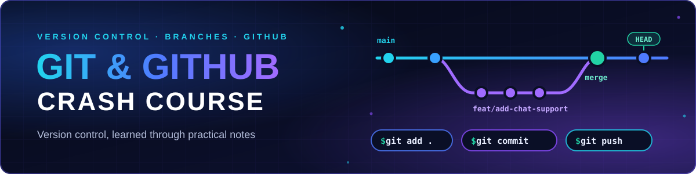
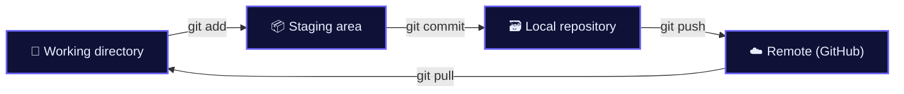

<p align="center">
  
</p>

<p align="center">
  <i>Practical notes on Git and GitHub: from your first commit to branches, rebase and stash.</i>
</p>

<p align="center">
  <a href="https://github.com/Pankaj-Jhajhria/Git-Crash-Course">
    
  </a>
</p>

<p align="center"></p>

<h2 align="center">🗺️ The Git cycle</h2>



The **staging area** collects exactly the changes you want to save. A **commit** records that staged snapshot in history with a message and an ID; **push** shares your commits with the remote.

<p align="center"></p>

<h2 align="center">🧩 Core concepts</h2>

| 🌱 **Git Basics** | 🔎 **History & Debugging** |
|:---|:---|
| Initialize a repo, check status, stage changes and commit.<br>[Open notes ↗](intro.txt#L3-L32) | Browse commits and see who changed what with `log`, `show` and `blame`.<br>[Open notes ↗](intro.txt#L20-L26) |

| ⏪ **Undo & Recovery** | ☁️ **GitHub & Remotes** |
|:---|:---|
| Move `HEAD` with `reset --hard`, or undo one commit with `revert`.<br>[Open notes ↗](intro.txt#L33-L48) | Connect a remote, push and pull, and sign in with SSH keys.<br>[Open notes ↗](intro.txt#L52-L84) |

| 🌿 **Branches & Merges** | 🧬 **Rebase & Stash** |
|:---|:---|
| Feature branches, naming conventions, merging and upstream branches.<br>[Open notes ↗](intro.txt#L84-L108) | Replay commits with `rebase`, and shelve unfinished work with `stash`.<br>[Open notes ↗](intro.txt#L109-L132) |

<p align="center"></p>

<h2 align="center">⌨️ Command reference</h2>

```bash
# Basics & history
git init
git status
git add .                          # or: git add <file>
git diff
git commit -m "message"
git commit -a -m "message"         # stage tracked changes + commit
git log --oneline
git show <commit_id>
git blame <file_path>

# Undo
git revert <commit_id>             # new commit that reverses an earlier one
git reset --hard <commit_id>       # ⚠️ moves HEAD; discards later commits and local changes

# GitHub & branches
git remote add origin git@github.com:<user>/<repo>.git
git remote -v
git push -u origin main
git pull
git checkout -b feat/add-chat-support   # newer equivalent: git switch -c
git push --set-upstream origin feat/add-chat-support
git merge <branch>                 # joins histories with a merge commit

# Rebase & stash
git rebase <branch>                # replays your commits on top of <branch> (new commits)
git rebase --abort
git stash
git stash apply
```

<p align="center"></p>

<h2 align="center">📚 Learning resources</h2>

| 📘 **Notes** | 📄 **Cheat sheet** | 🧪 **Practice files** |
|:---|:---|:---|
| [**intro.txt**](intro.txt)<br>All topics in one file | [**Git cheat sheet (PDF)**](git-cheat-sheet-education.pdf)<br>Two pages of commands | [index.js](index.js) · [script.js](script.js) · [Utils/util.js](Utils/util.js)<br>Edited during the exercises |

The [commit history](https://github.com/Pankaj-Jhajhria/Git-Crash-Course/commits/main) is part of the practice: it contains feature branches, merges and a revert.

<p align="center"></p>

<h2 align="center">🧭 Repository snapshot</h2>

```text
Git-Crash-Course/
├── intro.txt                        # the Git & GitHub notes
├── git-cheat-sheet-education.pdf    # 2-page cheat sheet
├── index.js · script.js             # small files used to practice commits and branches
└── Utils/util.js                    # tiny helper used in practice
```

<p align="center"></p>

<p align="center">
  Open the notes, run the commands, and make your own commits.<br>
  <a href="https://github.com/Pankaj-Jhajhria/Git-Crash-Course">github.com/Pankaj-Jhajhria/Git-Crash-Course</a> · Built by <b>Pankaj</b>
</p>
